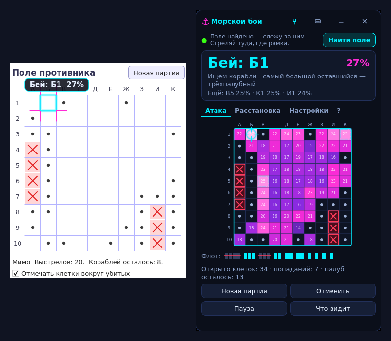
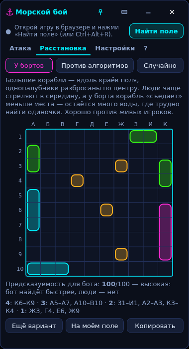
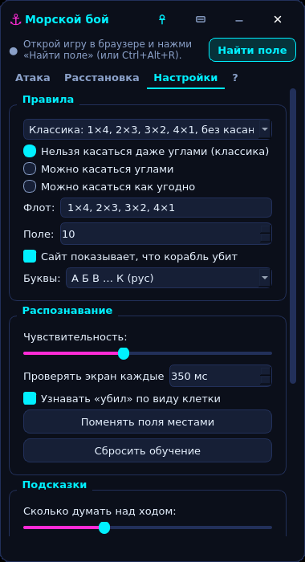

# ⚓ Морской бой — помощник

Маленькое окно **поверх всех окон** для игры в морской бой в браузере. Оно **смотрит на экран**,
само понимает «мимо / ранил / убил» на поле соперника и подсказывает, **куда бить**, —
с вероятностью попадания для каждой клетки. Может и **стрелять само** (автоигра), а ещё помогает
**расставить свои корабли**.



## Что умеет

- 🎯 **«Бей: Д5 · 63%»** — лучший выстрел, ещё 3 варианта и тепловая карта с процентами в каждой клетке.
  При «ранил» добивает и подсказывает, какой это скорее всего корабль (например, «скорее всего
  трёхпалубный, 52%»).
- 🤖 **Автоигра.** Кнопка «▶ Авто» (или Ctrl+Alt+A) — помощник сам щёлкает по лучшей клетке,
  ждёт отметку сайта и стреляет дальше; пока ход соперника — ждёт. Двинул мышь — пауза.
- 👁 **Видит поле на любом сайте.** Сам находит сетку на экране (или выдели поле рамкой) и следит
  за отметками кадр за кадром: работает со светлыми и тёмными темами, текстурой «воды»,
  «тетрадным листом» (как на Яндекс Играх: клетки по всей странице, поле — только в рамке),
  затемнением поля в ход соперника и подсветкой клетки под мышью.
- 🔤 **Называет клетки как сайт.** Сам видит, где на сайте буквы, а где цифры: на Яндекс Играх
  цифры сверху, поэтому «Бей: Д5» там значит строка Д, столбец 5.
- 🧠 **Учится.** Ошибся с клеткой — щёлкни по ней на поле помощника: он исправится и запомнит,
  как выглядят такие отметки на этом сайте. «Убил» узнаёт по смене вида клетки и по логике
  (например, вокруг убитого сайт ставит точки).
- 🪟 **Не мешает.** Окно поверх всех окон, мини-режим, прозрачность, перетаскивание за заголовок.
  Рамка-подсказка рисуется **прямо поверх игры**, клики проходят сквозь неё.
- 🚢 **Расстановка.** Три стратегии — «У бортов» (против людей), «Против алгоритмов»
  (против ботов) и «Случайно» — плюс оценка «предсказуемости для бота». Расстановку можно показать
  поверх своего поля на сайте и расставить корабли по образцу.
- ⚙ **Правила.** Переключатель касания кораблей (по умолчанию **классика — нельзя касаться даже
  углами**; ещё можно разрешить «углами» или «как угодно»), свой флот и размер поля,
  буквы А–К или A–J, готовые наборы (классика, классика с углами, Hasbro).
- 🧪 **Тренировка** — встроенная партия против компьютера: проверить помощника без сайта.
- ⌨ **Горячие клавиши:** Ctrl+Alt+H — показать/спрятать, Ctrl+Alt+O — рамка поверх игры,
  Ctrl+Alt+N — новая партия, Ctrl+Alt+R — найти поле заново, Ctrl+Alt+A — автоигра,
  Ctrl+Z — отменить исправление.
- 🙈 По желанию окно помощника **не попадает в скриншоты, запись экрана и стримы**
  (Windows 10 2004 и новее).

## Как запустить (Windows 10/11)

**Вариант 1 — готовый exe.** Скачай
[`SeaBattleHelper.exe`](https://github.com/pakipsaki333-cpu/vlad-neon-portfolio/releases/download/seabattle-v1.1.0/SeaBattleHelper.exe)
(страница релиза: [seabattle-v1.1.0](https://github.com/pakipsaki333-cpu/vlad-neon-portfolio/releases/tag/seabattle-v1.1.0);
свежие сборки — в [Actions](https://github.com/pakipsaki333-cpu/vlad-neon-portfolio/actions/workflows/seabattle-build.yml),
артефакт `SeaBattleHelper-windows`) и запусти. Устанавливать ничего не нужно. Windows может предупредить про неизвестного
издателя — «Подробнее → Выполнить в любом случае».

**Вариант 2 — из исходников.** Нужен [Python](https://www.python.org/downloads/) 3.10–3.14
(при установке отметь «Add python.exe to PATH»). Потом двойной щелчок по **`run.bat`**:
он сам создаст окружение, поставит зависимости и откроет помощника.

Собрать свой exe: **`build_exe.bat`** → `dist\SeaBattleHelper.exe`.

## Как пользоваться

1. Открой морской бой в браузере так, чтобы было видно поле соперника.
2. Нажми **«Найти поле»**. Помощник сделает снимок экрана и подсветит найденные поля —
   щёлкни по полю **соперника**. Не нашёл сам — выдели поле рамкой (точно по клеткам,
   без букв и цифр). Можно сразу указать и своё поле — для подсказок расстановки.
3. Стреляй туда, где светится рамка. Помощник сам увидит результат и пересчитает подсказку.
4. Если что-то распознано не так — щёлкни по клетке на поле помощника
   (мимо → ранил → убил → пусто) или правой кнопкой выбери нужное. Кнопка **«Что видит»**
   показывает, как помощник понял поле.
5. Хочешь, чтобы стрелял сам, — **«▶ Авто»** (см. ниже).

Без «Найти поле» помощник тоже работает: просто отмечай выстрелы на его поле вручную.

## Автоигра

Расставь корабли и начни партию на сайте, найди поле соперника («Найти поле»), потом нажми
**«▶ Авто»** рядом с подсказкой или **Ctrl+Alt+A**. Через 2 секунды (убери руку с мыши)
помощник начнёт сам:

- щёлкает по клетке, которую советует, и убирает курсор с поля, чтобы не мешать распознаванию;
- ждёт, пока сайт поставит отметку, и только потом думает над следующим выстрелом;
- сайт не ответил на щелчок — значит, сейчас ход соперника: ждёт и пробует снова;
- останавливается сам, если ты **двинул мышь**, все корабли соперника потоплены, поле пропало
  с экрана, началась новая партия или сайт долго не отвечает. Повторное нажатие «■ Стоп» или
  Ctrl+Alt+A — тоже стоп.

Пауза перед каждым выстрелом настраивается (0.2–5 с, «Настройки → Автоигра»). Окно помощника
не должно закрывать поле соперника — иначе щелчок попал бы в него (помощник это проверяет).
Автоигра щёлкает только в Windows и только по полю соперника. Расставлять корабли и начинать
партию она не умеет — у каждого сайта это устроено по-своему. И честнее включать её
в играх против компьютера, а не против живых людей.

## Правила, по которым он считает

Классика (сверено с Википедией и сайтами правил): поле 10×10, столбцы **А Б В Г Д Е Ж З И К**
(«Й» пропускают), строки 1–10. Флот — **10 кораблей**: 1 четырёхпалубный, 2 трёхпалубных,
3 двухпалубных, 4 однопалубных (всего 20 клеток). Корабли прямые, стоят по горизонтали или
вертикали, могут прижиматься к краю поля, но **не касаются друг друга ни сторонами, ни углами**.
После «ранил» или «убил» стреляешь ещё раз, после «мимо» ход переходит. На многих сайтах
вокруг убитого корабля сразу ставятся точки — помощник это использует.

Если на твоём сайте корабли могут касаться углами (или как угодно) — переключи это в настройках.



## Как он думает

Помощник перебирает тысячи расстановок вражеского флота, **которые не противоречат тому, что уже
известно** (промахи, попадания, убитые корабли, пустые клетки вокруг них, правило касания),
и для каждой клетки считает, в какой доле расстановок там стоит корабль. Это и есть процент.
Технически это цепь Маркова (MCMC) по расстановкам: проверено тестами, что её проценты совпадают
с **полным перебором всех расстановок** на маленьких полях (отклонение обычно меньше 1%).

Сравнение на 40 партиях на стратегию (классика, точки вокруг убитых ставятся):

| Стратегия стрельбы | Выстрелов до победы, в среднем |
|---|---|
| Случайные клетки | 75.5 |
| «Шахматка» + добивание соседних клеток (так играет опытный человек) | 58.6 |
| **Помощник** | **55.4** |

Помощник обгоняет «шахматку с добиванием» в 64% пар партий. Повторить: `python tools/simulate.py`.

**Честно:** гарантии победы нет — удача никуда не девается, и иногда соперник просто угадывает
быстрее. Помощник лишь даёт лучший по вероятности ход и не лезет в браузер — только смотрит
на экран, как ты сам. Без автоигры он **ничего не нажимает за тебя**; с автоигрой — щёлкает мышью
по полю соперника, как щёлкал бы ты. Учти, что на некоторых сайтах подсказчики и автоигра
в рейтинговых играх запрещены.

## Если распознаёт плохо

- Поле должно быть видно целиком; не перекрывай его другими окнами. Прокрутил страницу —
  помощник поищет поле сам, а если не найдёт — «Найти поле» (Ctrl+Alt+R).
- Отметки бледные или пропускаются — подними «Чувствительность» в настройках; ложные
  срабатывания — опусти.
- Сайт рисует промах красным (и помощник считает это попаданием) — исправь одну-две клетки,
  дальше он поймёт сам. «Сбросить обучение» — если сменил сайт.
- Помощник перепутал своё поле и поле соперника — «Поменять поля местами».
- Рамка-подсказка «съехала» с клеток — «Найти поле» ещё раз и щёлкни по полю. Если выделяешь
  рамкой, обводи по линиям поля; помощник сам подгонит рамку к сетке и к жирной рамке поля.
- Название клетки не совпадает с сайтом (буквы и цифры наоборот) — «Настройки → Подписи».
- Окно «Что видит» не клади на поле игры: в старых Windows помощник увидит его вместо игры.
- Не подходят: изометрические/3D-поля и поля, нарисованные не ровной сеткой.



## Для разработчиков

```bash
pip install -r requirements-dev.txt
python -m pytest                      # 102 теста: решатель, распознавание (и на настоящем
                                      # скриншоте), расстановка, автоигра
python -m seabattle --selftest out    # самопроверка: тренировка + захват экрана + отчёт
python -m seabattle --selftest out --auto   # то же, но играет автоигра настоящими щелчками мыши
python tools/simulate.py --games 40   # бенчмарк стратегий
python tools/screenshots.py docs      # скриншоты окна
```

Самопроверка открывает тренировочную партию, находит её поле **настоящим захватом экрана**,
доигрывает партию по подсказкам (выстрелы — через внутренний метод тренировки) и пишет
`report.json` со скриншотами. С `--auto` партию играет автоигра **настоящими щелчками мыши**
(SendInput), а тренировка после каждого промаха на секунду «отдаёт ход сопернику» и не принимает
щелчки. На GitHub Actions обе самопроверки проходят и исходный код, и собранный exe на Windows.

Устройство:

| Файл | Что делает |
|---|---|
| `seabattle/rules.py` | правила, флот, координаты «Д5» |
| `seabattle/board.py` | логика поля: кто убит, где точно пусто, проверка расстановки |
| `seabattle/solver.py` | вероятности (MCMC по расстановкам флота), лучший выстрел |
| `seabattle/vision.py` | поиск сетки на экране (линии или рамка поля), подписи, слежение за отметками, обучение |
| `seabattle/autoplay.py`, `mouse.py` | автоигра: когда и куда щёлкнуть; щелчки мышью в Windows |
| `seabattle/placement.py` | стратегии расстановки и «предсказуемость» |
| `seabattle/capture.py`, `winutil.py` | захват экрана, горячие клавиши, скрытие от записи |
| `seabattle/ui/` | окно помощника, рамка поверх игры, выбор поля, тренировка |
| `tests/` | тесты: синтетические «скриншоты» сайтов разных стилей и настоящий скриншот Яндекс Игр |

Стек: Python 3.10–3.14, PySide6 (Qt 6), numpy. Сборка exe — PyInstaller.

## Что нового

**1.1.0**
- 🤖 Автоигра: помощник сам стреляет по полю соперника (кнопка «▶ Авто», Ctrl+Alt+A).
- Яндекс Игры («Морской бой классический») и другие поля на «тетрадном листе»: поле находится
  само, а рамка больше не съезжает на клетку влево.
- Клетки называются как на сайте: если цифры сверху, «Д5» — строка Д, столбец 5 (сам определяет;
  можно выбрать вручную в настройках).
- «Что видит»: сетка больше не разъезжается при масштабе экрана 125–150%, окно открывается рядом
  с помощником и не попадает в захват экрана.
- Меньше ложных «Поле не на прежнем месте»: помощник не путает затемнение поля, накопившиеся
  отметки и собственную рамку-подсказку с прокруткой страницы, а если поле всё-таки потерялось —
  ищет его там же, где оно было (раньше мог перескочить на своё поле).
- Поле, запомненное прошлой версией со сдвигом, при запуске само сверяется с экраном и
  поправляется (если нет — просто нажми «Найти поле»).
- Тренировка: можно включить «ход соперника» после промаха — удобно проверить автоигру.

**1.0.0** — первая версия.
